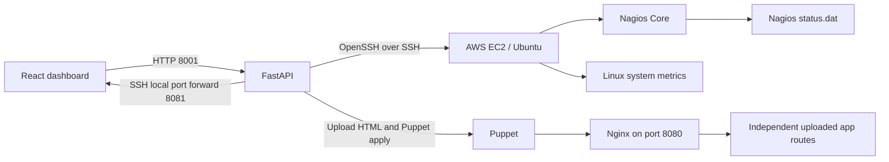

# Automated Server Monitoring and HTML Deployment

A Windows-friendly project dashboard for monitoring an Ubuntu AWS EC2 server and deploying independent static HTML applications. FastAPI reads Nagios and host metrics over SSH; React presents the live dashboard. Uploaded pages are installed by Puppet and served by Nginx, with a separate URL and Nagios HTTP check for every upload.

## What it does

- Reads Nagios Core service and host status from `status.dat`.
- Collects CPU, memory, disk, uptime, and service state from EC2 over SSH.
- Uploads one self-contained `.html` file at a time (maximum 256 KB).
- Gives every upload a unique ID and URL, even when two files have the same filename.
- Shows each uploaded application as its own dashboard card with its filename, URL, health state, open link, and delete action.
- Deletes only the selected app's EC2 directory and removes its corresponding Nagios check.
- Keeps the EC2 app port private; local browser access uses an SSH tunnel on port `8081`.

No uploaded page is deployed just by opening the dashboard. It appears in the application list only after an upload/deployment. Deleting it removes the card and the remote page.

## Architecture



The API uses one combined SSH snapshot for the monitoring dashboard. An HTML deployment stages its files together, applies a focused Puppet manifest, validates Nginx/Nagios configuration, and checks the new route before reporting success.

## Technology stack

### Application

- **Python 3.13**
- **FastAPI** for HTTP routes and request validation
- **Uvicorn** as the ASGI server
- **Pydantic** request models (through FastAPI)
- **python-dotenv** for optional local environment loading
- Python standard library: `subprocess`, `pathlib`, `tarfile`, `base64`, `uuid`, and `logging`
- **React 19**, **JavaScript ES modules**, and **Vite 7**
- **lucide-react** for dashboard icons
- Responsive dashboard styling in CSS

### Server and infrastructure

- **AWS EC2**, Ubuntu 24.04
- **OpenSSH** client and a PEM private key for API-to-EC2 access
- **Puppet 8.4.0** for application file deployment and service configuration
- **Nginx** for the uploaded pages (EC2 port `8080`)
- **Nagios Core 4.4.6** and its `check_http` plugin for application checks and host/service monitoring
- **Docker** and **Docker Compose** for the optional local containers
- **PowerShell** and Windows batch scripts for local setup and launch

### Development and tests

- **Node.js/npm** for frontend development and production builds
- **pytest** and **httpx** for backend API and parser tests

PostgreSQL-related values in `.env.example` are reserved placeholders; the current monitoring/deployment API does not connect to a database.

## Requirements

For the Windows one-click workflow:

- Windows 10/11 with PowerShell
- Python 3.13
- Node.js/npm
- OpenSSH client available as `ssh`
- A reachable EC2 Ubuntu host with Nginx, Nagios, and Puppet configured
- An SSH key with permission to run the project's required `sudo -n` commands on EC2

Docker Desktop with Docker Compose is needed only for the optional container workflow.

## Local setup (Windows)

### 1. Configure SSH

Copy the example settings and configure the EC2 host, SSH user, and private-key path:

```powershell
Copy-Item .env.example .env
```

Keep the PEM key outside the repository. Never put its contents in `.env`, source code, or the frontend. The backend reads the key path locally; it is not returned to the browser.

Confirm SSH access:

```powershell
ssh -i D:\aws-keys\automated-server-monitoring-key.pem ubuntu@15.135.200.112
```

The example host and key path are project defaults. Replace them with your own values in `.env`; if you change the SSH host/key, update the matching tunnel values in `start-dashboard.bat` as well.

### 2. Install backend dependencies

```powershell
py -3.13 -m venv .venv
.\.venv\Scripts\python.exe -m pip install -r backend\requirements.txt
```

### 3. Install frontend dependencies

```powershell
cd frontend
npm install
cd ..
```

### 4. Launch

Run `start-dashboard.bat` from Explorer or PowerShell. It starts/reuses:

- FastAPI at `http://127.0.0.1:8001`
- Vite dashboard at `http://localhost:3000`
- SSH tunnel at `http://localhost:8081` to EC2's private port `8080`

The script checks ports before starting services to avoid duplicate listeners. The tunnel requires the configured SSH key and an available local port `8081`.

Manual startup:

```powershell
# Terminal 1, from the repository root
.\.venv\Scripts\python.exe -m uvicorn backend.app.main:app --reload --host 127.0.0.1 --port 8001

# Terminal 2, from frontend\
npm run dev

# Terminal 3, if the SSH tunnel is not already running
ssh -i D:\aws-keys\automated-server-monitoring-key.pem -N -L 127.0.0.1:8081:127.0.0.1:8080 ubuntu@15.135.200.112
```

Open the dashboard at `http://localhost:3000` and API docs at `http://127.0.0.1:8001/docs`.

## Upload, open, and delete applications

1. In **Deploy applications**, choose a `.html` file up to 256 KB.
2. Select **Deploy selected HTML**. The page is transferred to EC2 and installed by Puppet.
3. Each deployment receives a distinct URL under `/apps/`, for example:
   `http://localhost:8081/apps/uploaded-my-page-<unique-id>/`
4. The dashboard adds an individual card named from the uploaded filename. The card's open control uses the local SSH tunnel.
5. Select **Delete** on a card to remove that one page, its metadata, and its Nagios check. Other uploaded pages remain.

Uploading the same filename again creates a new unique route; it does not overwrite the earlier application. The uploaded file must be a complete HTML page and should be self-contained. This uploader does not accept ZIPs, server-side code, or arbitrary assets.

The generated ID is stored with the page on EC2, so the inventory survives API restarts. Pages are served at:

```text
/apps/<unique-upload-id>/
```

EC2 port `8080` is intentionally not exposed by the local Docker Compose configuration. For direct public access, an administrator would need to configure the AWS security group; the project does not change AWS firewall rules.

## Puppet and Nagios behavior

- The **Puppet agent** should be enabled on EC2. To check/enable it:

  ```bash
  sudo systemctl enable --now puppet
  systemctl is-active puppet
  ```

- The API invokes a focused `puppet apply` manifest for each upload or deletion.
- Puppet installs the page under `/var/www/ams-demo/<unique-upload-id>/`, configures the Nginx app route, and maintains the generated Nagios app-check configuration.
- Nginx configuration is tested before the API reports a successful deployment.
- Each uploaded page gets its own Nagios HTTP check. Deleting a page removes its check instead of leaving a stale warning.
- The project does not automatically repair arbitrary server failures. Puppet's regular agent run applies the catalog; use `sudo puppet agent --test` for a manual run.

## API endpoints

### Monitoring

- `GET /api/health`
- `GET /api/dashboard` — combined monitoring snapshot and uploaded-app inventory
- `GET /api/monitor/status`
- `GET /api/monitor/services`
- `GET /api/monitor/alerts`
- `GET /api/monitor/summary`
- `GET /api/system/resources`
- `GET /api/infrastructure/status`

### Deployment

- `GET /api/deployment/apps` — returns currently uploaded applications only
- `POST /api/deployment/upload` — deploys one HTML file
- `DELETE /api/deployment/apps/{app_id}` — deletes only the selected upload
- `GET /api/deployment/status` — legacy demo deployment status
- `POST /api/deployment/apps/{app_id}` — legacy allowlisted sample deployment
- `POST /api/deploy/dummy-app` — legacy portfolio deployment

Example upload request:

```json
{
  "filename": "my-page.html",
  "content": "<!doctype html><html><head><title>My page</title></head><body>Hello</body></html>"
}
```

## Docker Compose

Configure `.env` first, including `SSH_KEY_PATH`, then run from the repository root:

```powershell
docker compose up --build
```

Services:

- Dashboard: `http://localhost:3000`
- API: `http://127.0.0.1:8001`
- Optional dummy site: `http://localhost:8082`

The backend container mounts the SSH key read-only at `/run/secrets/ec2.pem`. The API port is bound to loopback; do not expose it publicly. The frontend is a static production build served by Nginx inside its container.

## Tests and build

Run the backend tests:

```powershell
.\.venv\Scripts\python.exe -m pytest backend\tests -v
```

Build the frontend:

```powershell
cd frontend
npm run build
```

Validate Docker Compose:

```powershell
docker compose config --quiet
```

## Troubleshooting

- **Dashboard says SSH unavailable:** confirm `EC2_HOST`, `EC2_USER`, and `SSH_KEY_PATH` in `.env`; test an SSH login with the same key.
- **Upload fails during Puppet apply:** check that the key can use the required passwordless `sudo` commands and that Puppet, Nginx, and Nagios are installed and healthy on EC2.
- **App card says CHECK FAILED:** inspect the app route from EC2 with `curl -i http://127.0.0.1:8080/apps/<unique-upload-id>/`, then check Nginx and Puppet logs.
- **Open link does not load:** ensure the local SSH tunnel is running and listening on `8081`. The direct EC2 `8080` address is private by design.
- **Puppet agent is inactive:** run `sudo systemctl enable --now puppet` on EC2, then verify with `systemctl is-active puppet`.
- **API returns 503:** the backend could not complete its SSH command. Check network access, key permissions, remote service state, and the API log.
- **Nagios check not updated yet:** confirm Nagios configuration validation succeeded and refresh the dashboard after the forced/next service check.
