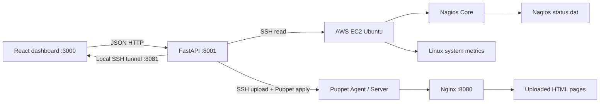

# Automated Server Monitoring and HTML Deployment

A Windows-friendly project dashboard for monitoring an Ubuntu AWS EC2 server and deploying independent static HTML applications. FastAPI reads Nagios and host metrics over SSH; React presents the live dashboard. Uploaded pages are installed by Puppet and served by Nginx, with a separate URL and Nagios HTTP check for every upload.

## What it does

- Reads Nagios Core service and host status from `status.dat`.
- Collects CPU, memory, disk, uptime, and service state from EC2 over SSH.
- Uploads one self-contained `.html` file at a time (maximum 256 KB).
- Gives every upload a unique ID and URL, even when two files have the same filename.
- Shows each uploaded application as its own dashboard card with its filename, URL, health state, open link, and delete action.
- Deletes only the selected app's EC2 directory and removes its corresponding Nagios check.
- Keeps the EC2 app port private; local browser access uses an SSH tunnel on port `8081`.

No uploaded page is deployed just by opening the dashboard. It appears in the application list only after an upload/deployment. Deleting it removes the card and the remote page.

### Scope and limitations

- The upload flow publishes **one static HTML document per deployment**. It does not build a React/Vue project, run server-side code, or deploy a ZIP.
- Keep CSS and JavaScript inline or use publicly reachable assets. The uploader does not transfer supporting files such as images or stylesheets.
- The backend currently has no user login or role-based access control. Keep the API bound to localhost and do not publish it directly to the internet.
- The project has no active database integration. Uploaded-page inventory is discovered from the EC2 app folders and their stored filename metadata.
- Deleting a page removes its remote app directory. It does not delete the local source HTML file selected by the user.

## Architecture



### Request and data flow

1. The dashboard calls `GET /api/dashboard` and polls on the configured interval (30 seconds by default).
2. FastAPI opens an SSH connection and runs a combined, read-only snapshot command on EC2. The response includes Nagios status, CPU/memory/disk/uptime values, service states, and uploaded-app inventory.
3. Nagios writes its status to `/var/lib/nagios4/status.dat`. The API reads it with `sudo -n` and parses hosts, services, plugin output, state, and check timestamps.
4. On upload, FastAPI validates the filename and HTML, makes an ID from a normalized filename plus a UUID, and stages the page, metadata, Nginx configuration, Nagios configuration, and Puppet manifest as one archive.
5. Puppet installs only that app's files, updates the shared route/check configuration, and reloads the relevant services when configuration changes.
6. FastAPI validates Nginx and Nagios configuration and requests the new EC2 route. The upload is reported successful only when the health check returns HTTP `200`.
7. An SSH local port forward maps the browser's `localhost:8081` to EC2's private `127.0.0.1:8080`.

The archive staging avoids separate SSH transfers for each deployment file. Deployment still waits for Puppet to apply the catalog and for Nginx/Nagios checks to finish.

## Repository map

| Path | Purpose |
| --- | --- |
| `backend/app/main.py` | FastAPI app, route registration, validation, and HTTP error responses |
| `backend/app/config.py` | EC2 host/user/key defaults and runtime configuration |
| `backend/app/monitoring.py` | SSH monitoring commands, combined dashboard snapshot, and resource parsing |
| `backend/app/nagios_parser.py` | Parses Nagios `status.dat` host/service records |
| `backend/app/deployment.py` | HTML validation, unique IDs, archive staging, Puppet apply, verification, and deletion |
| `backend/tests/` | API, upload lifecycle, and Nagios parser tests |
| `frontend/src/App.jsx` | Dashboard, upload controls, application cards, and monitoring views |
| `frontend/src/api.js` | Browser-side API requests and error handling |
| `frontend/src/styles.css` | Responsive dashboard styling |
| `demo-apps/` | Local sample HTML files for legacy allowlisted demo endpoints |
| `puppet/manifests/` and `puppet/files/` | Puppet manifests and Nginx configuration source |
| `nagios/services/` | Nagios command and service configuration source |
| `scripts/deployment/` | Windows preflight and deployment helper scripts |
| `docker-compose.yml`, `backend/Dockerfile`, `frontend/Dockerfile` | Optional local containers |
| `dummy-app/` | Optional standalone container demo on local port `8082` |

## Technology stack

### Application

- **Python 3.13**
- **FastAPI** for HTTP routes and request validation
- **Uvicorn** as the ASGI server
- **Pydantic** request models (through FastAPI)
- **python-dotenv** for optional local environment loading
- Python standard library: `subprocess`, `pathlib`, `tarfile`, `base64`, `uuid`, and `logging`
- **React 19**, **JavaScript ES modules**, and **Vite 7**
- **lucide-react** for dashboard icons and `@vitejs/plugin-react` for Vite's React integration
- Responsive dashboard styling in CSS

### Server and infrastructure

- **AWS EC2**, Ubuntu 24.04
- **OpenSSH** client and a PEM private key for API-to-EC2 access
- **Puppet 8.4.0** for application file deployment and service configuration
- **Nginx** for the uploaded pages (EC2 port `8080`)
- **Nagios Core 4.4.6** and its `check_http` plugin for application checks and host/service monitoring
- **Docker** and **Docker Compose** for the optional local containers; the frontend container uses Node.js 20 for its build and Nginx 1.27 Alpine to serve the static bundle
- **PowerShell** and Windows batch scripts for local setup and launch

### Development and tests

- **Node.js/npm** for frontend development and production builds
- **pytest** and **httpx** for backend API and parser tests

The backend container is based on Python 3.13 slim and installs the OpenSSH client. The EC2 app server and the local frontend container are separate Nginx deployments.

## Requirements

For the Windows one-click workflow:

- Windows 10/11 with PowerShell
- Python 3.13
- Node.js/npm
- OpenSSH client available as `ssh`
- A reachable EC2 Ubuntu host with Nginx, Nagios, and Puppet configured
- An SSH key with permission to run the project's required `sudo -n` commands on EC2

Docker Desktop with Docker Compose is needed only for the optional container workflow.

## Configuration reference

The backend loads `.env` through `python-dotenv` when it is installed. The current backend reads:

| Variable | Used by | Purpose / default |
| --- | --- | --- |
| `EC2_HOST` | Backend and Docker Compose | EC2 host or IP; project default is `15.135.200.112` |
| `EC2_USER` | Backend and Docker Compose | SSH login user; project default is `ubuntu` |
| `SSH_KEY_PATH` | Backend and Docker Compose | Local PEM path; default is `D:\aws-keys\automated-server-monitoring-key.pem`. Compose mounts it read-only as `/run/secrets/ec2.pem`. |
| `VITE_API_URL` | Frontend build | Optional API base URL; defaults to `http://127.0.0.1:8001`. In Docker it is a build argument, not a runtime setting. |

The following values currently appear in `.env.example` or Compose but are **not read by the application code**: `APP_ENV`, `APP_NAME`, `BACKEND_HOST`, `BACKEND_PORT`, `POSTGRES_DB`, `POSTGRES_USER`, `POSTGRES_PASSWORD`, and `API_SECRET_KEY`. There is no configured PostgreSQL client or API-key authentication. `NAGIOS_STATUS_PATH` is currently fixed in `backend/app/config.py` to `/var/lib/nagios4/status.dat`, even though an example value is present in `.env.example` and Compose. Do not rely on changing it through the environment.

The Windows tunnel command in `start-dashboard.bat` has its own EC2 host, SSH user, and key values. If those differ from the backend settings, update the batch file as well.

## Local setup (Windows)

### 1. Configure SSH

Copy the example settings and configure the EC2 host, SSH user, and private-key path:

```powershell
Copy-Item .env.example .env
```

Edit the `EC2_HOST`, `EC2_USER`, and `SSH_KEY_PATH` entries in `.env` to match your EC2 instance. Do not put private-key contents in this file.

Keep the PEM key outside the repository. Never put its contents in `.env`, source code, or the frontend. The backend reads the key path locally; it is not returned to the browser.

Confirm SSH access:

```powershell
ssh -i D:\aws-keys\automated-server-monitoring-key.pem ubuntu@15.135.200.112
```

The example host and key path are project defaults. Replace them with your own values in `.env`; if you change the SSH host/key, update the matching tunnel values in `start-dashboard.bat` as well.

### 2. Install backend dependencies

```powershell
py -3.13 -m venv .venv
.\.venv\Scripts\python.exe -m pip install -r backend\requirements.txt
```

### 3. Install frontend dependencies

```powershell
cd frontend
npm install
cd ..
```

### 4. Launch

Run `start-dashboard.bat` from Explorer or PowerShell. It starts/reuses:

- FastAPI at `http://127.0.0.1:8001`
- Vite dashboard at `http://localhost:3000`
- SSH tunnel at `http://localhost:8081` to EC2's private port `8080`

The script checks ports before starting services to avoid duplicate listeners. The tunnel requires the configured SSH key and an available local port `8081`.

The browser dashboard and API can run without the tunnel, but the **Open app** links need it. Port `8081` is used locally because port `8080` may already be occupied by Jenkins and the EC2 app port is kept private.

Manual startup:

```powershell
# Terminal 1, from the repository root
.\.venv\Scripts\python.exe -m uvicorn backend.app.main:app --reload --host 127.0.0.1 --port 8001

# Terminal 2, from frontend\
npm run dev

# Terminal 3, if the SSH tunnel is not already running
ssh -i D:\aws-keys\automated-server-monitoring-key.pem -N -L 127.0.0.1:8081:127.0.0.1:8080 ubuntu@15.135.200.112
```

Open the dashboard at `http://localhost:3000` and API docs at `http://127.0.0.1:8001/docs`.

## Upload, open, and delete applications

1. In **Deploy applications**, choose a `.html` file up to 256 KB.
2. Select **Deploy selected HTML**. The page is transferred to EC2 and installed by Puppet.
3. Each deployment receives a distinct URL under `/apps/`, for example:
   `http://localhost:8081/apps/uploaded-my-page-<unique-id>/`
4. The dashboard adds an individual card named from the uploaded filename. The card's open control uses the local SSH tunnel.
5. Select **Delete** on a card to remove that one page, its metadata, and its Nagios check. Other uploaded pages remain.

Uploading the same filename again creates a new unique route; it does not overwrite the earlier application. The uploaded file must be a complete HTML page and should be self-contained. This uploader does not accept ZIPs, server-side code, or arbitrary assets.

The app ID consists of a safe filename-derived slug and a UUID. The original filename is stored in `.display-name` in the app's EC2 folder and is what the dashboard displays. The inventory is rebuilt from those marked folders, so it survives API restarts without a local database. Pages are served at:

```text
/apps/<unique-upload-id>/
```

Each uploaded route serves that app folder's own `index.html` and sends no-cache headers so browsers do not reuse an older page response.

EC2 port `8080` is intentionally not exposed by the local Docker Compose configuration. For direct public access, an administrator would need to configure the AWS security group; the project does not change AWS firewall rules.

### Upload validation and lifecycle

- The filename must be a single `.html` filename, not a path.
- The content must be non-empty, contain an HTML document tag, and be at most 256 KB after UTF-8 encoding.
- The generated ID is used for the directory, URL, and Nagios service name. Two uploads with the same filename therefore remain separate.
- The upload endpoint stages a tar archive over SSH, applies a generated Puppet manifest, validates Nginx and Nagios configuration, and checks the resulting route.
- The delete endpoint validates the app ID format and looks it up in EC2 inventory before removing anything. Puppet removes only that app's directory; the Nagios configuration is regenerated without its service.
- An app with a failed HTTP check remains in the inventory with a **CHECK FAILED** state, so it can still be deleted.
- A successful delete returns `deleted: true`; the dashboard removes that card and refreshes the monitoring snapshot.

## Puppet and Nagios behavior

- The **Puppet agent** should be enabled on EC2. To check/enable it:

  ```bash
  sudo systemctl enable --now puppet
  systemctl is-active puppet
  ```

- The API invokes a focused `puppet apply` manifest for each upload or deletion.
- Puppet installs the page under `/var/www/ams-demo/<unique-upload-id>/`, configures the Nginx app route, and maintains the generated Nagios app-check configuration.
- Nginx configuration is tested before the API reports a successful deployment.
- Each uploaded page gets its own Nagios HTTP check. Deleting a page removes its check instead of leaving a stale warning.
- The project does not automatically repair arbitrary server failures. Puppet's regular agent run applies the catalog; use `sudo puppet agent --test` for a manual run.
- Each app check uses the Nagios `check_http` plugin against the private EC2 Nginx route. Check results may take a short time to appear in `status.dat` after Nagios reloads.

### EC2 prerequisites

The SSH identity must be able to run the project's remote commands non-interactively with `sudo -n`. The deployment path uses `ssh`, `tar`, `base64`, `curl`, `puppet apply`, `nginx -t`, `nagios4 -v`, and systemd service operations. Confirm these dependencies and file locations match the target Ubuntu/Nagios installation before using a different server image.

Useful EC2 checks:

```bash
systemctl is-active puppet nginx nagios4
sudo nginx -t
sudo nagios4 -v /etc/nagios4/nagios.cfg
sudo test -r /var/lib/nagios4/status.dat && echo "Nagios status is readable"
```

## API endpoints

### Monitoring

| Method and path | Description |
| --- | --- |
| `GET /` | Basic service identity and running status |
| `GET /api/health` | Local FastAPI health check; does not prove EC2 is reachable |
| `GET /api/dashboard` | Combined Nagios, resource, infrastructure, and uploaded-app snapshot |
| `GET /api/monitor/status` | Parsed Nagios hosts, services, and summary |
| `GET /api/monitor/services` | Nagios service list and count |
| `GET /api/monitor/alerts` | Services whose Nagios state is not OK |
| `GET /api/monitor/summary` | Nagios summary, creation time, and host data |
| `GET /api/system/resources` | CPU, memory, disk, and uptime from EC2 |
| `GET /api/infrastructure/status` | Nginx, Puppet, Nagios, and host reachability |

`GET /api/dashboard` returns one JSON object with four main sections:

```json
{
  "monitor": {
    "created": 1795584194,
    "summary": {
      "total_hosts": 1,
      "total_services": 9,
      "ok": 9,
      "warning": 0,
      "critical": 0,
      "unknown": 0
    },
    "hosts": [],
    "services": []
  },
  "resources": {
    "cpu": 6.7,
    "memory": { "total_bytes": 953643008, "used_bytes": 724213760, "available_bytes": 229429248 },
    "disk": { "total_bytes": 19682557952, "used_bytes": 5179273216, "available_bytes": 14486507520 },
    "uptime": "up 10 hours, 18 minutes",
    "source": "EC2 read-only SSH commands"
  },
  "infrastructure": {
    "nginx": { "status": "active", "verified": true },
    "puppet_agent": { "status": "active", "verified": true },
    "nagios_core": { "status": "active", "verified": true }
  },
  "applications": []
}
```

The values above are illustrative. A monitoring service state is `0` for OK, `1` for WARNING, `2` for CRITICAL, or `3` for UNKNOWN. `GET /api/health` is intentionally a lightweight local check; use `/api/dashboard` to verify SSH and EC2 reachability too.

### Deployment

| Method and path | Description |
| --- | --- |
| `GET /api/deployment/apps` | Uploaded-app inventory discovered on EC2 |
| `POST /api/deployment/upload` | Validate and deploy one HTML page |
| `DELETE /api/deployment/apps/{app_id}` | Remove one uploaded app and its Nagios check |
| `GET /api/deployment/status` | Legacy demo deployment status |
| `POST /api/deployment/apps/{app_id}` | Legacy allowlisted sample deployment |
| `POST /api/deploy/dummy-app` | Legacy portfolio deployment |

Example upload request:

```json
{
  "filename": "my-page.html",
  "content": "<!doctype html><html><head><title>My page</title></head><body>Hello</body></html>"
}
```

An example successful upload response looks like:

```json
{
  "id": "uploaded-my-page-370d9f4910a349a6a736934f65242d33",
  "name": "my-page.html",
  "description": "Uploaded HTML application",
  "deployed": true,
  "status_code": 200,
  "path": "/apps/uploaded-my-page-370d9f4910a349a6a736934f65242d33/",
  "url": "http://<EC2_PUBLIC_IP>:8080/apps/uploaded-my-page-370d9f4910a349a6a736934f65242d33/",
  "tunnel_url": "http://localhost:8081/apps/uploaded-my-page-370d9f4910a349a6a736934f65242d33/",
  "port": 8080,
  "public_access_depends_on_security_group": true
}
```

The upload response also includes the app port and a flag indicating that public access depends on the AWS security group. A delete response includes `deleted: true` when the selected page was confirmed removed. Typical errors are `400` for invalid HTML, `404` for an unknown app ID, `422` for malformed/missing request fields, and `503` when SSH or a remote deployment step fails.

The API is documented interactively by FastAPI at `http://127.0.0.1:8001/docs`. For a live check from PowerShell:

```powershell
Invoke-RestMethod http://127.0.0.1:8001/api/health
Invoke-RestMethod http://127.0.0.1:8001/api/deployment/apps
Invoke-RestMethod http://127.0.0.1:8001/api/dashboard
```

## Security notes

- The Windows launcher binds FastAPI to `127.0.0.1`; Compose also publishes its API only on `127.0.0.1`. Preserve these loopback bindings.
- CORS allows the local frontend origins `http://localhost:3000` and `http://127.0.0.1:3000`. CORS is not authentication.
- Keep the PEM private key outside Git and mount it read-only when using Docker. The frontend never receives the key.
- Remote commands use non-interactive SSH and `sudo -n`. Configure the EC2 account with only the required administrative permissions; do not make the key or API public.
- SSH uses `BatchMode=yes`, a connection timeout, and `StrictHostKeyChecking=accept-new`. For long-lived production environments, pin and manage the EC2 host key rather than relying on first-use acceptance.
- The HTML upload is a static content feature, not a sandbox for untrusted scripts. Only allow trusted users to access the local dashboard/API.
- Public reachability of EC2 port `8080` is controlled by AWS security-group/network policy and is not modified by this repository.

## Docker Compose

Configure `.env` first, including `SSH_KEY_PATH`, then run from the repository root:

```powershell
docker compose up --build
```

Services:

- Dashboard: `http://localhost:3000`
- API: `http://127.0.0.1:8001`
- Optional dummy site: `http://localhost:8082`

The backend container mounts the SSH key read-only at `/run/secrets/ec2.pem`. The API port is bound to loopback; do not expose it publicly. The frontend is a static production build served by Nginx inside its container.

Compose port mappings are loopback-only: backend container port `8000` is published as host port `8001`, frontend container port `80` as host port `3000`, and the optional dummy site as host port `8082`. Docker Compose does not create the EC2 SSH tunnel; run the local tunnel separately if using an app's local link.

Stop the stack with:

```powershell
docker compose down
```

Rebuild after a source or Dockerfile change:

```powershell
docker compose up --build
```

## Tests and build

Run the backend tests:

```powershell
.\.venv\Scripts\python.exe -m pytest backend\tests -v
```

Build the frontend:

```powershell
cd frontend
npm run build
```

Validate Docker Compose:

```powershell
docker compose config --quiet
```

Run all repository Python tests rather than only the backend tests with:

```powershell
.\.venv\Scripts\python.exe -m pytest -v
```

The frontend package currently defines `dev`, `build`, and `preview` scripts. There is no separate frontend unit-test or lint script configured.

## Troubleshooting

- **Dashboard says SSH unavailable:** confirm `EC2_HOST`, `EC2_USER`, and `SSH_KEY_PATH` in `.env`; test an SSH login with the same key and verify the host accepts the key.
- **Local API health is OK but the dashboard is empty:** `/api/health` checks FastAPI only. Open `/api/dashboard` or check the API's 503 detail for the underlying SSH/Nagios problem.
- **Upload returns 400:** use a single `.html` file, ensure it contains an HTML document, remove unsupported path characters, and keep it within 256 KB.
- **Upload fails during Puppet apply:** check passwordless `sudo -n` access, Puppet connectivity to its server, and the API detail/log for the failed command. On EC2, inspect `sudo journalctl -u puppet -n 50 --no-pager`.
- **App card says CHECK FAILED:** inspect the app route from EC2 with `curl -i http://127.0.0.1:8080/apps/<unique-upload-id>/`, then check `sudo tail -n 50 /var/log/nginx/error.log` and the Puppet/Nginx service state.
- **Open link does not load:** ensure the local SSH tunnel is listening on `8081`; use `Get-NetTCPConnection -LocalPort 8081 -State Listen` on Windows. The direct EC2 `8080` address is private by design.
- **Puppet agent is inactive:** run `sudo systemctl enable --now puppet` on EC2, then verify with `systemctl is-active puppet`.
- **Nagios reports invalid configuration:** run `sudo nagios4 -v /etc/nagios4/nagios.cfg`; check that `/usr/lib/nagios/plugins/check_http` exists and that the Nginx route responds locally.
- **Nagios check has not changed yet:** confirm Nagios configuration validation/reload succeeded, then wait for the next check and refresh the dashboard. Read the latest state from `/var/lib/nagios4/status.dat`.
- **Docker API cannot find the key:** verify that `SSH_KEY_PATH` in `.env` points to an existing host file and that Compose mounted it read-only as `/run/secrets/ec2.pem`.
- **Port is already in use:** close the conflicting process or choose an unused port. Do not terminate an unrelated service just to free a port.
